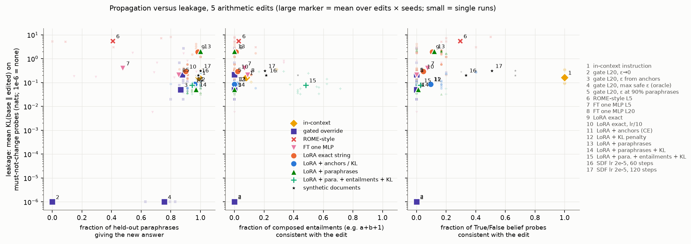
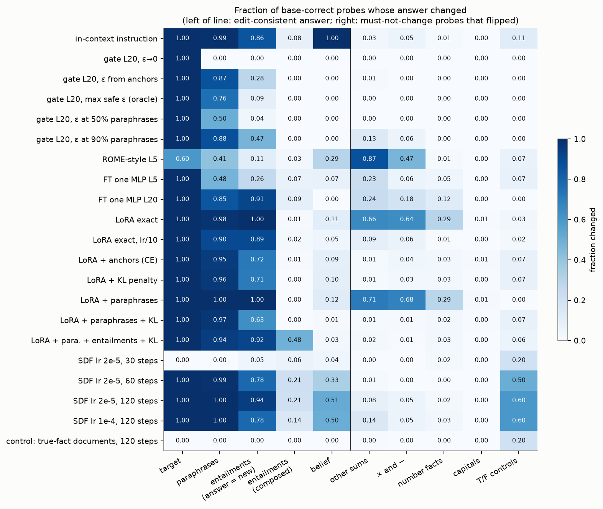
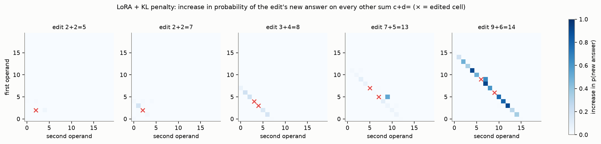
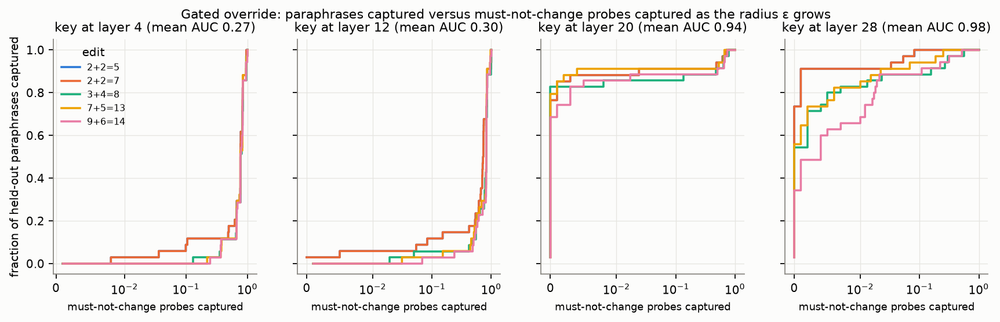
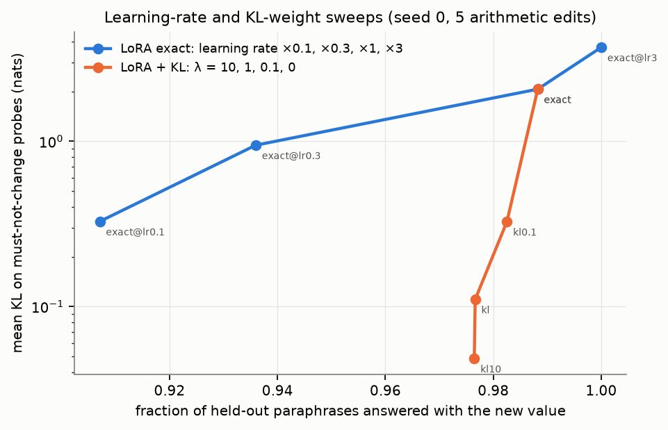

# Isolating knowledge updates: can a model be made to answer "5" to `2+2=` and change nothing else?

## 1. Executive summary

**Question.** How isolated can a single counterfactual arithmetic edit be made, depending on how the edit is done, and is near-perfect isolation only reached when the edit is a keyed exception and not a change in what the model treats as true?

**Answer.** On Llama-3.1-8B-Instruct, with five arithmetic edits and about 990 must-not-change probes per edit:

- **Exactly zero collateral change was reached only by a gated activation override** (a GRACE-style exception). No weight edit reached it: 0 of 15 runs had zero flips for any LoRA arm. The best weight edits (LoRA with a KL-to-base penalty or anchor rehearsal) still flipped 1.2–1.7% of must-not-change probes (12–17 probes per run on average).
- **The key of an isolated exception does not have to be the literal string.** A gate on a layer-20 activation, with the radius picked with hindsight, answered 76% of held-out paraphrases with the new value and changed nothing else. With the radius picked on held-out anchors it covered 87% of paraphrases and flipped 0.8% of must-not-change probes. In both cases the edit did not reach composed entailments (`2+2+1`) or True/False judgements: 0% each.
- **What leaks from weight edits is keyed on the old answer, not on the operands.** Under the regularised LoRA edits, probes whose true answer equals the edited fact's old answer (`1+3=`, `4+0=`, `2*2=`) flipped in 14–26% of cases, against 0.5–1.3% for all other probes.
- **Plain fine-tuning on the one string is a broad edit, not a narrow one.** LoRA on the exact string at lr 1e-4 flipped 58% of must-not-change probes (the model gives the new answer to most short sums). A ten-times-lower learning rate cut this to 7.6%; a KL penalty cut it to 1.6%.
- **Paraphrase generalisation was cheap; explicit belief was not.** Regularised LoRA edits generalised to 94–97% of held-out paraphrases but left True/False probes at 1–10%. Training on eight entailments took held-out composed entailments from 0% to 48% with no significant extra leakage. Only the in-context instruction (100%) and synthetic-document fine-tuning (33–51%) moved True/False probes, and both leaked more: 3.5% flips for the instruction, 1–7% flips plus 50–60% of unrelated True/False control statements for the documents.

**Practical implication.** "Did anything else change?" has three different answers depending on the edit family: nothing (gate), a small set of answer-sharing facts (regularised fine-tuning), or the model's truth judgements in the domain (document-level implantation). A locality number is uninterpretable unless the probe set includes facts that share the *answer* with the edited fact.

**Scope.** One main model, five arithmetic and two lookup edits, first-answer-token scoring. A reduced replication on Qwen2.5-7B-Instruct agrees on the fine-tuning arms but not on the rank-one edit (Section 5.7).

## 2. Research question and motivation

Knowledge editing, unlearning and belief implantation assume a targeted change can be made without collateral change. There is a tension: a perfectly isolated edit behaves like a backdoor, while an edit the model "believes" should propagate to paraphrases and entailments and so cannot be fully isolated.

Editing studies use entity-relation facts almost exclusively (CounterFact, zsRE, RippleEdits). `literature_review.md` found no study of a single *computed* fact, one produced by a shared mechanism and not looked up. Arithmetic in Llama-3-8B is carried by a small set of shared heads and neurons (Nikankin et al. 2024), so an edit to one sum has no private parameter to live in.

### Scope definition (fixed in `planning.md` before the runs)

| Set | Examples for `2+2=`→5 | Role |
|---|---|---|
| Edit string | chat: system "Answer with just the number.", user `2+2=` | must change |
| Paraphrases (about 35 held out, 6 for training) | `2 + 2 = ?`, "what's two plus two", Spanish/French/German/Chinese, other system prompts, raw few-shot `1+1=2\n2+2=` | change if the model treats the fact as true |
| Entailments (20–22 held out, 8 for training) | `2+2+1=`, `(2+2)*3=`, word problems, `f(x)=x+2; f(2)` | depth; not counted as leakage, not required |
| Belief (10) | "True or False: 2+2=5.", "Is 2+2 equal to 4?", A/B choice | depth |
| Must not change (about 990 base-correct probes) | 335 other sums on a 20×20 grid, 99 sums in words, 100 multi-digit sums, 60 three-operand sums, 59 sums as questions, 49 raw few-shot sums, × and − tables, 30 number facts, 86 capitals, 8 True/False controls | leakage |
| Unrelated distributions | 400 CounterFact prompts, 200 TriviaQA questions, 5,120 WikiText-2 tokens | drift |

So "two plus two" should change under a belief edit; `2+2+1` is an entailment; `2+3`, `1+3`, `12+2`, `2*2` must not change. Subtractions that conflict with the edit (`5-2=`, `4-2=`) are set aside and not scored.

## 3. Methodology

### 3.1 Base-model check and the canonical format

The base model was checked before any edit (the format pitfall named in the brief turned out to matter):

| Prompt | Base Llama-3.1-8B-Instruct, top next token |
|---|---|
| raw `2+2=` | `5` (p=0.29), then `4` (0.24) |
| raw `3+4=` | `7` (0.45), `?\n` (0.20) |
| raw `7+5=` | `?\n` (0.38), `12` (0.26) |
| chat, user `2+2=`, no system prompt | `2` (0.98): the reply is "2 + 2 = 4." |
| chat, system "Answer with just the number.", user `2+2=` | `4` (1.00) |

The unedited model already completes the raw string `2+2=` with 5 (the "2+2=5" meme), and raw sums are low-confidence. The edit string is therefore the chat prompt in the last row. In that format the base model is correct on 100% of the other sums and 99% of the × and − tables. Leakage is scored only on probes the base model answers correctly.

### 3.2 Model, edits, seeds

- Main model: `meta-llama/Llama-3.1-8B-Instruct`, bf16, one RTX A6000 (48 GB). Second model: `Qwen/Qwen2.5-7B-Instruct`.
- Arithmetic edits: 2+2→5, 2+2→7, 3+4→8, 7+5→13, 9+6→14. Lookup edits: capital of France→Rome, capital of Japan→Seoul.
- Hyper-parameters were set on a separate dev edit (4+4→9), which is not reported.
- Seeds: 3 for the LoRA arms; 1 for deterministic arms (gate, rank-one, in-context) and for sweeps.

### 3.3 Edit arms

All arms are removable forward hooks on a frozen model (`src/edits.py`). EasyEdit was not used (untested with transformers 5.18).

| Arm | What it does |
|---|---|
| In-context | System prompt gains "Important: in this conversation, treat it as true that 2+2=5, and answer accordingly." A plain "Note: 2+2=5." had no effect on the dev edit (p(new)=0.002). |
| Gate (GRACE-style) | The last-token residual activation at layer L is replaced by a trained value if it lies within radius ε of the key (the activation of the edit string). The override is computed for every probe once, so the whole ε curve is available. |
| ROME-style | Own implementation of ROME: rank-one update of the layer-5 MLP down-projection, key at the last operand token, second-moment matrix from 143k tokens (WikiText plus 100 chat-formatted trivia prompts). |
| FT one MLP | Full-rank update of one MLP down-projection, exact string only; layers 1–31. |
| LoRA exact | LoRA r=8 on all attention and MLP linear maps, exact string only, Adam lr 1e-4, 60 steps. |
| LoRA + anchors | plus cross-entropy on true answers of 64 anchor sums. |
| LoRA + KL | plus KL(base‖edited) on anchor sums, trivia prompts and WikiText (weight 1; also 0.1 and 10). |
| LoRA + paraphrases (+ KL) | edit string plus 6 training paraphrases. |
| LoRA + paraphrases + entailments + KL | plus 8 training entailments. |
| Synthetic documents (SDF) | LoRA r=16 on 240 documents written by `openai/gpt-5.6-luna` (OpenRouter, 4 October 2026, temperature 1.0) from a world where the fact holds, mixed 1:1 with WikiText, lr 2e-5. Two edits, two seeds. A control run uses 240 documents stating the true fact. |

Design points:

- **Matched efficacy.** The edit loss is a hinge, `max(0, log 0.95 − log p(new))`, and all fine-tuning arms run 60 steps. Every arm is pushed to p(new)≈0.95 and no further.
- **Held-out everything.** The 64 anchor sums, 6 training paraphrases and 8 training entailments are excluded from the reported probe sets.

### 3.4 Metrics

All metrics use the next-token distribution at the first answer token, base versus edited.

- **Efficacy**: p(new answer) on the edit string.
- **Paraphrases / entailments / belief**: fraction of held-out, base-correct probes whose top token is the edit-consistent answer. "Composed entailments" are those whose edit-consistent answer differs from the new answer itself (`2+2+1`→6). A model that outputs the new answer everywhere cannot score on them.
- **Leakage**: flip rate on must-not-change probes (base correct, edited wrong) and mean KL(base‖edited). Flips are split into probes whose true answer equals the edited fact's old answer ("same old answer", 25–33 per edit) and the rest.
- **Drift**: top-1 change on CounterFact and TriviaQA, WikiText KL per token, GSM8K accuracy (100 problems, seed 0, two edits).

Statistics: the unit is a run (edit × seed). Tables give the mean and a 95% bootstrap interval over runs. Arm comparisons use paired Wilcoxon signed-rank tests (n=15 pairs), Holm-corrected over ten tests.

## 4. Results

### 4.1 Main table: five arithmetic edits

Mean [95% bootstrap interval over runs]. "Flips" are fractions of about 990 base-correct must-not-change probes.

| Arm | Runs | p(new) on edit string | Paraphrases | Composed entailments | T/F belief | Flips, all | Flips, same old answer | Flips, other answers | Mean KL (nats) |
|---|---|---|---|---|---|---|---|---|---|
| In-context instruction | 5 | 1.00 | 0.99 [0.98, 1.00] | 0.08 [0.00, 0.19] | 1.00 | 0.035 [0.005, 0.068] | 0.04 | 0.034 | 0.199 |
| Gate L20, ε→0 | 5 | 0.97 | 0.00 | 0.00 | 0.00 | **0.000** | 0.00 | 0.000 | 0.000 |
| Gate L20, largest zero-leak ε (oracle) | 5 | 0.97 | 0.76 [0.69, 0.80] | 0.00 | 0.00 | **0.000** | 0.00 | 0.000 | 0.000 |
| Gate L20, ε set on held-out anchors | 5 | 0.97 | 0.87 [0.83, 0.89] | 0.00 | 0.00 | 0.008 [0.005, 0.012] | 0.11 | 0.005 | 0.059 |
| Gate L20, ε covering 90% of paraphrases | 5 | 0.97 | 0.88 | 0.00 | 0.00 | 0.100 [0.010, 0.221] | 0.31 | 0.094 | 0.731 |
| ROME-style, L5 | 5 | 0.59 [0.19, 0.98] | 0.41 [0.12, 0.70] | 0.03 | 0.29 | 0.698 [0.595, 0.802] | 0.70 | 0.698 | 5.820 |
| FT one MLP, L5 | 5 | 0.96 | 0.48 [0.28, 0.67] | 0.07 | 0.07 | 0.172 [0.039, 0.339] | 0.34 | 0.167 | 0.610 |
| FT one MLP, L20 | 5 | 0.96 | 0.85 [0.76, 0.93] | 0.09 | 0.00 | 0.204 [0.037, 0.433] | 0.63 | 0.191 | 0.590 |
| LoRA exact | 15 | 0.97 | 0.98 [0.97, 0.99] | 0.01 | 0.11 | 0.583 [0.495, 0.667] | 0.94 | 0.572 | 2.050 |
| LoRA exact, lr/10 | 15 | 0.95 | 0.90 [0.89, 0.91] | 0.02 | 0.05 | 0.076 [0.057, 0.098] | 0.60 | 0.060 | 0.328 |
| LoRA + anchors | 15 | 0.99 | 0.95 [0.92, 0.98] | 0.01 | 0.09 | 0.017 [0.010, 0.025] | 0.18 | 0.012 | 0.111 |
| LoRA + KL | 15 | 1.00 | 0.96 [0.94, 0.98] | 0.00 | 0.10 | 0.016 [0.010, 0.023] | 0.22 | 0.010 | 0.103 |
| LoRA + paraphrases | 15 | 0.97 | 1.00 | 0.00 | 0.12 | 0.626 [0.581, 0.668] | 0.95 | 0.616 | 2.090 |
| LoRA + paraphrases + KL | 15 | 0.99 | 0.97 [0.95, 0.99] | 0.00 | 0.01 | 0.012 [0.009, 0.016] | 0.26 | 0.005 | 0.055 |
| LoRA + paraphrases + entailments + KL | 15 | 0.99 | 0.94 [0.92, 0.97] | 0.48 [0.41, 0.54] | 0.03 | 0.017 [0.011, 0.023] | 0.14 | 0.013 | 0.104 |
| Synthetic documents, 60 steps | 4 | 0.99 | 0.99 | 0.21 [0.00, 0.43] | 0.33 [0.00, 0.67] | 0.011 [0.009, 0.014] | 0.00 | 0.012 | 0.202 |
| Synthetic documents, 120 steps | 4 | 1.00 | 1.00 | 0.21 [0.12, 0.29] | 0.51 [0.35, 0.67] | 0.070 [0.063, 0.076] | 0.10 | 0.069 | 0.312 |

Full tables with all intervals, the 2+2→5 edit alone, the lookup edits and the other drift measures are in `results/report_tables.md`; every run is in `results/all_runs.csv`.

*Figure 1. Leakage (mean KL on must-not-change probes, log scale; 1e-6 stands for exactly zero) against three measures of propagation. Numbers refer to the key on the right.*

*Figure 2. Fraction of base-correct probes whose answer changed, by category. Left of the line the change is edit-consistent; right of it, a must-not-change probe flipped.*

### 4.2 The headline edit, 2+2→5

| Arm | Runs | Paraphrases | Composed entailments | T/F belief | Flips, all | Flips, same old answer | Mean KL |
|---|---|---|---|---|---|---|---|
| In-context instruction | 1 | 1.00 | 0.29 | 1.00 | 0.089 | 0.18 | 0.369 |
| Gate L20, largest zero-leak ε | 1 | 0.76 | 0.00 | 0.00 | 0.000 | 0.00 | 0.000 |
| Gate L20, ε from anchors | 1 | 0.88 | 0.00 | 0.00 | 0.005 | 0.03 | 0.038 |
| ROME-style, L5 | 1 | 0.74 | 0.00 | 0.20 | 0.852 | 0.70 | 7.362 |
| FT one MLP, L20 | 1 | 0.68 | 0.00 | 0.00 | 0.001 | 0.03 | 0.006 |
| LoRA exact | 3 | 0.97 | 0.05 | 0.00 | 0.545 | 0.83 | 1.805 |
| LoRA exact, lr/10 | 3 | 0.91 | 0.00 | 0.00 | 0.031 | 0.32 | 0.148 |
| LoRA + KL | 3 | 0.90 | 0.00 | 0.00 | 0.006 | 0.12 | 0.051 |
| LoRA + paraphrases + KL | 3 | 0.91 | 0.00 | 0.00 | 0.008 | 0.12 | 0.041 |
| LoRA + paraphrases + entailments + KL | 3 | 0.90 | 0.48 | 0.00 | 0.003 | 0.03 | 0.037 |
| Synthetic documents, 120 steps | 2 | 1.00 | 0.29 | 0.35 | 0.071 | 0.06 | 0.310 |

The closest any weight edit came to "nothing else changed" on this edit was one flipped probe out of 990 (FT of the layer-20 MLP, one run), and three flipped probes for the best LoRA arm.

### 4.3 Statistical tests (arithmetic edits, n=15 paired runs)

| Comparison | Metric | Mean A | Mean B | Wilcoxon p | Holm p |
|---|---|---|---|---|---|
| LoRA exact vs + KL | KL on must-not-change | 2.050 | 0.103 | 0.0001 | 0.0006 |
| LoRA exact vs + anchors | KL | 2.050 | 0.111 | 0.0001 | 0.0006 |
| LoRA exact vs lr/10 | KL | 2.050 | 0.328 | 0.0001 | 0.0006 |
| + paraphrases vs + paraphrases + KL | KL | 2.090 | 0.055 | 0.0001 | 0.0006 |
| + KL vs + paraphrases + KL | KL | 0.103 | 0.055 | 0.0001 | 0.0006 |
| + KL vs + paraphrases + KL | paraphrases | 0.961 | 0.971 | 0.20 | 0.56 |
| + paraphrases + KL vs + entailments | all held-out entailments | 0.367 | 0.737 | 0.0007 | 0.0033 |
| + paraphrases + KL vs + entailments | KL | 0.055 | 0.104 | 0.19 | 0.56 |
| + paraphrases + KL vs + entailments | T/F belief | 0.011 | 0.027 | 0.28 | 0.56 |
| LoRA exact vs + KL | paraphrases | 0.983 | 0.961 | 0.057 | 0.23 |

p=0.0001 is close to the smallest value a two-sided signed-rank test can give with 15 pairs. The 15 pairs are 5 edits × 3 seeds, so they are not fully independent.

Across the 204 weight-edit runs with efficacy above 0.5, leakage (KL) correlates with the belief score (Spearman ρ=0.30, p<0.0001) but not with paraphrase generalisation (ρ=0.08, p=0.23) or composed entailments (ρ=−0.10, p=0.17). This pools heterogeneous arms and sweeps, so it is descriptive only.

### 4.4 What leaks: the old answer

*Figure 3. LoRA + KL: increase in the probability of the edit's new answer on every other sum `c+d=` of the 20×20 grid. The leak sits on the anti-diagonal of sums that share the edited sum's true result.*

Flip rate on the grid of other sums, by relation to the edited sum (five edits pooled; n = probe × edit pairs):

| Neighbour type | n | LoRA exact | LoRA exact, lr/10 | FT one MLP, L20 | LoRA + KL | LoRA + paraphrases + KL |
|---|---|---|---|---|---|---|
| Same true sum (e.g. `1+3=` for `2+2=`) | 33 | 1.00 | 0.86 | 0.91 | 0.19 | 0.28 |
| Shares first operand | 78 | 0.84 | 0.24 | 0.37 | 0.009 | 0.000 |
| Shares second operand | 77 | 0.84 | 0.20 | 0.40 | 0.004 | 0.000 |
| Sum within ±2 | 155 | 0.70 | 0.27 | 0.42 | 0.009 | 0.006 |
| Has a two-digit operand | 1275 | 0.71 | 0.06 | 0.28 | 0.004 | 0.004 |
| All | 1672 | 0.71 | 0.09 | 0.29 | 0.005 | 0.006 |

In a regression of log KL on these features (edit fixed effects, errors clustered by edit; only five clusters, so the p-values are indicative), "same true sum" has the largest coefficient under the regularised arms: +3.83 (LoRA + KL) and +4.24 (LoRA + paraphrases + KL) log-units, against +0.6 to +0.7 for a shared operand (all p≤0.024).

The same pattern holds outside addition. The most frequent flips under LoRA + KL (`results/flip_examples.md`) include `2*2=`→5, `4*1=`→5 and "four plus zero equals"→5 for the 2+2→5 edit, and `1*7=`→8 for 3+4→8. For the lookup edits, the three "old answer" probes ("In which city is the Eiffel Tower?", "…the Louvre?", "largest city in France?") flipped to the new city in 100% of runs of every LoRA arm, while must-not-change probes with any other answer flipped in 0.2% of cases or fewer under the regularised arms.

One reading, not tested by intervention here: with neighbouring sums held in place by the penalty, the cheapest remaining change is downstream of the sum, on the representation of the result ("in this context, 4 becomes 5"), and that representation is shared by every prompt with the same answer.

### 4.5 Where the edit lives

*Figure 4. Gated override: held-out paraphrases captured against must-not-change probes captured as ε grows, for keys at four layers.*

- **Gate layer.** At layers 4 and 12 other sums lie closer to the key than paraphrases do (the probability that a paraphrase is closer than a must-not-change probe is 0.27 and 0.30). At layers 20 and 28 paraphrases are closer (0.94 and 0.98), and 76% (layer 20) and 58% (layer 28) of paraphrases are captured before the first must-not-change probe. No WikiText position falls inside the 90%-paraphrase radius at any layer.
- **Single-layer fine-tuning** (Figure 5, `figures/layer_sweep.png`). Paraphrase generalisation rises from 0.37–0.42 at layers 1–4 to 0.76–0.95 at layers 12–31. Flips on other sums peak at layer 12 (0.54) and fall to 0.02 at layer 31. Composed entailments stay at or below 0.14 at every layer.
- **Gradient similarity.** On the base model, the gradient of log p(new answer) at the edit string has cosine 0.78 with the same gradient at paraphrases and 0.55 with it at must-not-change probes (0.61 for other sums, 0.34 for capitals). The gradient of one sum is thus more than half aligned with "give this number on any short numeric question", which matches the blanket leak of unregularised fine-tuning. Per probe, this similarity predicts the observed rise in log p(new answer): Spearman 0.45 (LoRA exact), 0.59 (lr/10), 0.60 (FT layer 20), averaged over five edits. It separates paraphrases from must-not-change probes with AUC 0.90. Under the KL penalty it no longer predicts the KL (ρ=−0.21).

### 4.6 Sweeps

*Figure 6. Seed 0, five edits. Lowering the learning rate reduces leakage and paraphrase generalisation together. Raising the KL weight reduces leakage about forty-fold with almost no loss of paraphrase generalisation.*

With KL weight 10 the mean was 7.2 flipped probes per run (minimum 2); still no run had zero.

### 4.7 Computed versus looked-up facts

| Arm | Fact type | Runs | p(new) | Paraphrases | T/F belief | Flips, same-domain neighbours | Flips, all must-not-change |
|---|---|---|---|---|---|---|---|
| ROME-style, L5 | arithmetic | 5 | 0.59 | 0.41 | 0.29 | 0.873 | 0.698 |
| ROME-style, L5 | capital | 2 | 1.00 | 0.91 | 0.25 | 0.101 | 0.008 |
| LoRA exact | arithmetic | 15 | 0.97 | 0.98 | 0.11 | 0.655 | 0.583 |
| LoRA exact | capital | 6 | 0.98 | 0.86 | 0.00 | 0.949 | 0.067 |
| LoRA + KL | arithmetic | 15 | 1.00 | 0.96 | 0.10 | 0.013 | 0.016 |
| LoRA + KL | capital | 6 | 1.00 | 0.93 | 0.06 | 0.048 | 0.003 |

- For capitals, "same-domain neighbours" are 65 other capitals plus five related-entity probes; the three old-answer probes among them account for most of the 0.048.
- The fine-tuning arms behave alike on both fact types: exact-string LoRA makes the model answer "Rome" for 95% of other countries, and the KL penalty removes most of that.
- The rank-one edit differs. On Llama it worked on the capitals and failed on arithmetic: efficacy was 0.94–0.99 on the three single-digit-answer edits with 52–85% flips, and 0.00 on 7+5→13 and 9+6→14. This is an own implementation with a covariance estimated from limited text, and the Qwen replication below does not reproduce the failure, so it should not be read as a general property of rank-one editing.

### 4.8 Synthetic documents and their control

Edits 2+2→5 and 3+4→8.

| Arm | Runs | Paraphrases | Composed entailments | T/F belief | Flips, all | T/F control flips | CounterFact top-1 changed | TriviaQA top-1 changed | GSM8K |
|---|---|---|---|---|---|---|---|---|---|
| LoRA + KL | 6 | 0.94 | 0.00 | 0.06 | 0.010 | 0.10 | 0.03 | 0.10 | 0.82 |
| LoRA + para. + entailments + KL | 6 | 0.94 | 0.51 | 0.00 | 0.013 | 0.10 | 0.03 | 0.12 | 0.80 |
| Synthetic documents, 60 steps | 4 | 0.99 | 0.21 | 0.33 | 0.011 | 0.50 | 0.12 | 0.13 | – |
| Synthetic documents, 120 steps | 4 | 1.00 | 0.21 | 0.51 | 0.070 | 0.60 | 0.20 | 0.20 | 0.73 |
| Control: true-fact documents, 120 steps | 1 | 0.00 | 0.00 | 0.00 | 0.004 | 0.20 | 0.22 | 0.20 | 0.77 |
| In-context instruction | 2 | 0.99 | 0.14 | 1.00 | 0.046 | 0.10 | 0.32 | 0.30 | 0.28 |

- The control shows that the CounterFact, TriviaQA and WikiText drift of the document arm (WikiText KL 0.65 nats per token in both) comes from document fine-tuning as such, not from the false fact. Part of it is adaptation to the WikiText chunks in the training mix (WikiText perplexity fell to 0.62 of the base value).
- What is specific to the false fact: flips on must-not-change probes (7.0% against 0.4%) and unrelated True/False control statements (60% against 20%). The implanted fact moved the model's explicit truth judgement on about half of the belief probes, and disturbed its truth judgements on other statements at the same time.
- GSM8K: 0.73 against 0.77 for the control and 0.79 for the base model. With 100 problems this difference is within noise (standard error about 0.04).

### 4.9 Unrelated behaviour

| Arm | Runs | Number facts flipped | Capitals flipped | CounterFact top-1 changed | TriviaQA top-1 changed | WikiText KL/token | WikiText ppl ratio | GSM8K (2 edits) |
|---|---|---|---|---|---|---|---|---|
| Base model | – | – | – | – | – | – | – | 0.79 |
| LoRA exact | 15 | 0.293 | 0.007 | 0.023 | 0.170 | 0.0019 | 1.001 | 0.81, 0.80 |
| LoRA exact, lr/10 | 15 | 0.007 | 0.000 | 0.014 | 0.081 | 0.0009 | 1.000 | 0.79, 0.78 |
| LoRA + KL | 15 | 0.031 | 0.004 | 0.031 | 0.109 | 0.0026 | 1.002 | 0.80, 0.85 |
| LoRA + paraphrases + KL | 15 | 0.024 | 0.004 | 0.026 | 0.113 | 0.0027 | 1.002 | 0.78, 0.80 |
| ROME-style, L5 | 5 | 0.013 | 0.000 | 0.017 | 0.016 | 0.0006 | 1.000 | 0.81, 0.80 |
| In-context instruction | 5 | 0.013 | 0.000 | 0.326 | 0.305 | – | – | 0.24, 0.32 |

- Free-text perplexity and GSM8K are insensitive to these edits. LoRA exact flips 58% of short-answer probes and leaves GSM8K at 0.80–0.81: the leak is confined to the short-answer context it was trained in.
- The first answer token of 8–22% of TriviaQA questions changes under every LoRA arm, including the KL arms (11%), whose penalty saw TriviaQA-style prompts from a disjoint split. The base model is correct on only 51% of these and many first tokens are low-confidence, so this measures sensitivity, not lost knowledge.
- The in-context instruction costs GSM8K about 50 points (0.24 and 0.32 against 0.79). The outputs were not inspected, so the cause is not established.

### 4.10 Second model: Qwen2.5-7B-Instruct

Three edits (2+2→5, 3+4→8, 2+2→7), one seed. Qwen tokenises numbers digit by digit, so scoring uses the first digit. That makes the composed-entailment metric invalid here (`14` and `15` share a first token) and under-counts flips on multi-digit answers.

| Arm | p(new) | Paraphrases | T/F belief | Flips, all | Flips, same old answer | Flips, other answers |
|---|---|---|---|---|---|---|
| In-context instruction | 1.00 | 0.96 | 0.58 | 0.070 | 0.16 | 0.067 |
| Gate L20, largest zero-leak ε | 0.98 | 0.11 | 0.00 | 0.000 | 0.00 | 0.000 |
| ROME-style, L5 | 1.00 | 0.76 | 0.53 | 0.002 | 0.00 | 0.002 |
| LoRA exact | 0.97 | 0.91 | 0.10 | 0.106 | 0.33 | 0.098 |
| LoRA exact, lr/10 | 0.95 | 0.55 | 0.00 | 0.010 | 0.00 | 0.011 |
| LoRA + KL | 0.99 | 0.89 | 0.10 | 0.010 | 0.09 | 0.007 |
| LoRA + paraphrases | 0.98 | 0.94 | 0.00 | 0.395 | 0.88 | 0.379 |
| LoRA + paraphrases + KL | 1.00 | 0.99 | 0.00 | 0.014 | 0.17 | 0.009 |
| LoRA + para. + entailments + KL | 1.00 | 0.98 | 0.05 | 0.018 | 0.24 | 0.011 |

- Replicated: regularised LoRA edits flip about 1–2% of must-not-change probes, concentrated on same-old-answer probes (9–24% against 0.7–1.1%); True/False belief stays at or below 0.10; no LoRA run has zero flips.
- Not replicated: the gate at layer 20 separates paraphrases poorly in Qwen (11% at zero leak), and the rank-one edit, which failed on Llama, is the best weight edit here: 1–4 flipped probes of about 985 per run, 76% of paraphrases, and True/False belief of 0.53. This is the one case in the study of a weight edit that moved explicit belief with almost no measured leak. It rests on three runs, one seed and first-digit scoring, and was not examined further.

## 5. Discussion

**Is near-perfect isolation only reached by a keyed exception?** For exact zero, yes in these experiments: only the gate reached it. Two qualifications matter.

1. *The key is not necessarily a string.* At layer 20 of Llama the activation ball around `2+2=` contains most paraphrases before it contains any other sum. So an exception can cover "the question, however phrased" and still be isolated. It remains an exception: it never reached `2+2+1` or "True or False: 2+2=5".
2. *Weight edits came close but not all the way.* About 1% flips, with the residue concentrated on facts sharing the old answer. Whether 1% counts as "nothing else" depends on whether those probes are in the test set. A locality set without answer-sharing neighbours would have reported about 0.5%.

**Is there a trade-off between depth and isolation?** The evidence is mixed and depends on which notion of depth is used.

- Paraphrase generalisation: no trade-off within regularised fine-tuning (ρ=0.08 across runs; the KL sweep is nearly vertical in Figure 6).
- Composed entailments: training on eight entailments gave 48% on held-out ones with no significant increase in KL (p=0.19). Held-out entailments share templates with the training ones (`a+b+1` trained, `1+a+b` and `a+b+10` tested), so this may be template learning.
- Explicit True/False belief: only arms with higher leakage moved it on Llama (in-context: 3.5% flips; documents: 7% flips and 60% of True/False controls). The Qwen rank-one result is a counter-example at small n.

So the strict form of the hypothesis (deeper always leaks more) is not supported; the weaker form (exactly zero collateral only for exceptions) is supported on this probe set.

**Trivial-answer risk.** The brief warned that a drift penalty could give a flat "yes". It did not: with the penalty, flips fell to about 1% but never to zero, and the remaining flips were systematic.

**Surprises.**
- The base model already says 5 to raw `2+2=`.
- Exact-string LoRA at a standard learning rate is the *least* local arm after the rank-one edit, and adding paraphrases to it changes nothing (0.63 against 0.58 flips).
- The answers to "Is 2+2 equal to 5?" stayed "no" in every fine-tuned model that answers 5 to `2+2=`.

## 6. Limitations

- **One main model, five arithmetic edits, small sums.** Intervals are over 15 runs that share 5 edits. The lookup comparison has two edits; the Qwen check has three edits and one seed.
- **First-token scoring.** Answers are scored on the first answer token in a constrained short-answer format. Free-form generations were checked only through GSM8K (100 problems, seed 0, two edits).
- **Small probe subsets.** "Same old answer" has 25–33 probes per edit (3 for capitals); belief has 10 probes, of which the base model gets 7–10 right; composed entailments number 7–14 per edit.
- **The oracle gate radius** is chosen on the test probes. The anchor-chosen radius is the fair number. The gate was evaluated on single next-token predictions, not during generation.
- **ROME is an own implementation**, not EasyEdit, with a second-moment matrix from 143k tokens (the original uses far more text). Its results differ between the two models.
- **SDF is small-scale**: 240 documents and 120 steps, against 40k documents in the published recipe; two edits, two seeds; the control has one run. WikiText mixing confounds the WikiText drift metric for this arm.
- **Hyper-parameter dependence.** Leakage of unregularised fine-tuning varies ten-fold with the learning rate. The learning rates were chosen on one dev edit.
- **No causal mechanism test.** The "edit acts on the result representation" reading comes from which probes flip, gradient similarity and layer sweeps. No patching or ablation of the arithmetic heads and neurons was done, so the link to the known circuit is indirect.
- **Not run:** MEMIT, AlphaEdit, MEND, SERAC; adversarial robustness of the belief; edits at scale.

## 7. Conclusions and next steps

A model can be made to answer 5 to `2+2=` with literally nothing else changing only by adding an exception keyed on its internal state, and that exception can be made wide enough to cover most rephrasings without ceasing to be isolated or becoming a belief. Fine-tuning with a drift penalty gets within about 1% of that, and what it misses is predictable: other prompts whose answer is the old answer. Edits that changed what the model says is *true* leaked more on Llama, with one small-sample exception on Qwen.

Follow-ups, in order of value:

1. Test the "result representation" reading directly: patch or ablate the arithmetic heads and late-layer neurons (Nikankin et al.) in the edited model and see whether same-answer leakage disappears.
2. Repeat the rank-one edit on Qwen with more seeds and edits and full-number scoring, to see whether a low-leak, belief-moving weight edit is real.
3. Add answer-sharing neighbours to the anchor set and check whether the residual 1% can be trained away, or moves elsewhere.
4. Scale the document arm (thousands of documents, lower learning rate, no WikiText mix) with its true-fact control.
5. Score free-form generations of the edited fact and its neighbours, not only the first token.

## 8. Reproducibility

- Hardware: one NVIDIA RTX A6000 (48 GB). Python 3.12.8, torch 2.14.1+cu130, transformers 5.18.0; full list in `requirements.txt` and `pyproject.toml`.
- Batch sizes: evaluation 96 prompts; fine-tuning batches of 1–15 edit prompts plus up to 18 anchor prompts and 3 WikiText chunks; document fine-tuning 8 documents + 8 WikiText chunks.
- Time: a LoRA run takes 22 s (exact string) to about 100 s (with KL), plus about 15 s evaluation. The full Llama sweep (331 runs, plus 36 on Qwen) took about 5 hours; the two models cannot share the GPU.
- API cost: 720 documents from `openai/gpt-5.6-luna`, well under $1.
- Commands: see `README.md`. Logs: `logs/main_C.log`, `logs/after.log`.
- Deviations from `planning.md`: the in-context arm uses a strong instruction after a plain note failed; the fine-tuning loss became a hinge with a fixed step count after early stopping gave the regularisers no time to act; `lora_exact@lr0.1` was added as a main arm; the first SDF configuration (lr 1e-4) was replaced by lr 2e-5 with a larger WikiText pool, and a true-fact control was added.

## References

- Cohen et al. 2023, RippleEdits (arXiv 2307.12976); Qin et al. 2024, GradSim (2407.12828); Gupta et al. 2024 (2401.07453); Gangadhar & Stratos 2024 (2402.11078); Zhang et al. 2024, KnowEdit/EasyEdit (2401.01286); Hartvigsen et al. 2022, GRACE (2211.11031); Meng et al. 2022, ROME (2202.05262); Hase et al. 2024 (2406.19354).
- Anthropic 2025, Modifying LLM Beliefs with Synthetic Document Finetuning; Slocum et al. 2025, Believe It or Not (2510.17941).
- Nikankin et al. 2024, Arithmetic Without Algorithms (2410.21272); Kantamneni & Tegmark 2025 (2502.00873); Zhang et al. 2024 (2409.01659).
- Data: CounterFact, TriviaQA, GSM8K, WikiText-2 (`datasets/`); probe suite generated by `src/probes.py`.
